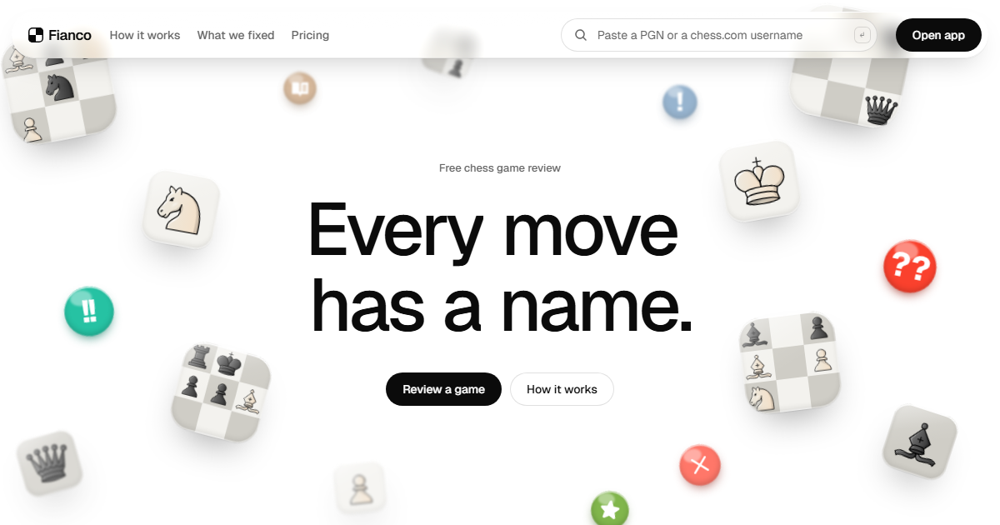
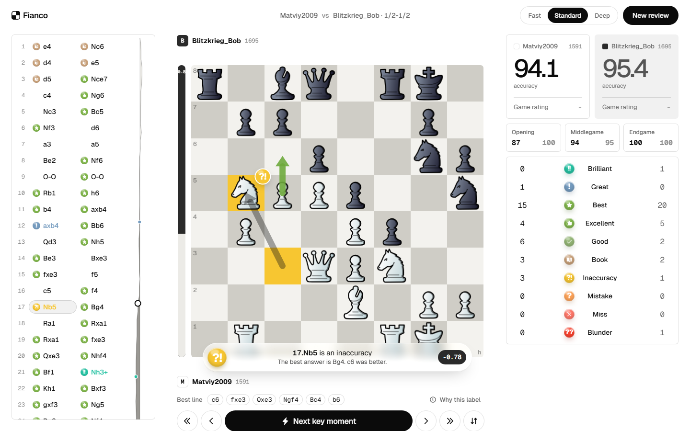
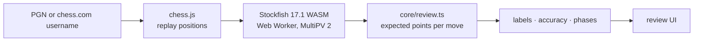

<div align="center">

<a href="https://fianco.app"></a>

# Fianco

**Every move has a name.**<br />
Free, unlimited chess game review that runs in your browser.

[**fianco.app**](https://fianco.vercel.app/) &nbsp;·&nbsp; [Review a game](https://fianco.app/#/review) &nbsp;·&nbsp; [How it works](#how-it-works) &nbsp;·&nbsp; [Run it locally](#run-it-locally)


<a href="https://fianco.app"></a>

</div>

> Game review is the most useful thing a chess site offers, and it's usually rationed to one game a day.
> Fianco gives every game a full review, for free, because the engine runs on your own machine.

<br />

## Why Fianco

Built from what players keep asking for on forums and reviews.

| You said | Fianco |
|---|---|
| One full review a day, more costs ~$100 a year | **Unlimited.** Stockfish runs locally, nothing to ration |
| "My brilliant disappeared next week" | **Same answer every time.** Fixed strength, shown on screen |
| I can't see my move and the best move together | **Both arrows at once**, plus the best line written out |
| The eval graph vanishes once I start stepping | **The graph never leaves.** It runs beside the move list |
| "It says blunder. But why?" | **Every label explains itself:** what hangs, what the reply wins, the win chance lost |
| Over-the-board games need workarounds | **Any game:** paste a PGN or type a chess.com username |

<br />

<div align="center"></div>

<br />

## Move labels

Each move is judged by how much of your winning chance it gives away, measured at your rating.

| | Label | When it's given |
|:-:|---|---|
|  | **Brilliant** | A sound piece sacrifice that you didn't need to be winning already to find |
|  | **Great** | The only good move, or the one that turns the game |
|  | **Best** | The engine's top choice |
|  | **Excellent** | Almost as strong as the best move |
|  | **Good** | Keeps the position, gives a little away |
|  | **Book** | A known opening move |
|  | **Inaccuracy** | A small slip |
|  | **Mistake** | A real loss of advantage |
|  | **Miss** | Your opponent erred and you didn't punish it |
|  | **Blunder** | Loses material or allows mate |
|  | **Forced** | The only legal move |

The colours are the ones chess players already read, so nothing has to be relearned.

<br />

## How it works



- **Expected points.** Every evaluation becomes a win chance for the player to move, on a curve that steepens with rating
  (a 0.6 pawn edge means more at 2200 than at 800).
- **Labels.** The win chance lost against the best move sets the base label. Rules on top add Book, Forced, Great
  (the only good move), Brilliant (a sacrifice confirmed by static exchange evaluation) and Miss (a punishment you skipped).
- **Accuracy.** Each move scores 0 to 100 from the win chance it lost; a game's accuracy blends those scores so one
  blunder counts more than a plain average would let it.
- **Everything is local.** Your games never leave your machine. The only network calls are to load the site and,
  if you use a username, chess.com's public read-only API.

<br />

## Features

- Unlimited reviews, no account
- Import by chess.com username or any PGN
- Opens your games from your side of the board
- Move labels, accuracy per player and per phase
- Both arrows on the board, best line written out, "why this label" with the numbers
- Next key moment (Space), full keyboard control
- Fast, Standard and Deep strengths
- Smart caption that moves away from the action
- Installable as an app, works on phones

<br />

## Run it locally

```bash
git clone https://github.com/zerovisuals/Fianco.git
cd Fianco
npm install
npm run dev        # http://localhost:5180
```

`npm run build` writes a static site to `dist/`. It needs the `Cross-Origin-Opener-Policy` and
`Cross-Origin-Embedder-Policy` headers for multithreaded Stockfish; `app/public/_headers` sets them on Cloudflare Pages.

<br />

## Project

#### `app/`
The site. Landing page at `/`, review app at `/#/review`. React, Vite and Motion, plain CSS.

#### `core/`
The review model: expected points, classification rules, accuracy. Pure TypeScript, shared by the app and the tooling.

#### `app/public/engine/`
Stockfish 17.1 compiled to WebAssembly, run in a Web Worker on the visitor's machine.

<br />

## Roadmap

- [x] Unlimited in-browser review
- [x] chess.com username and PGN import
- [ ] Game rating estimate
- [ ] Shareable review cards
- [ ] Lichess import
- [ ] Practice your key moments
- [ ] **Pro** (optional): insights across all your games, drills from your mistakes, repertoire, coach explanations, sync

Reviewing a game stays free. Always.

<br />

## Credits

- [Stockfish](https://stockfishchess.org) (GPL-3.0), via [stockfish.js](https://github.com/nmrugg/stockfish.js)
- Piece sets via [Lichess](https://github.com/lichess-org/lila): celtic by [Maurizio Monge](https://github.com/maurimo/chess-art) (MIT), merida by Armando Hernandez Marroquin (GPL-2.0+), chessnut by [Alexis Luengas](https://github.com/LexLuengas/chessnut-pieces) (Apache-2.0), cburnett by Colin M.L. Burnett (GPL-2.0+)
- Move sounds: "Chess_foley" by [Amatsuuu](https://freesound.org/s/629181/) on Freesound (CC0); Brilliant sound from the Lichess "sfx" set by [Enigmahack](https://github.com/Enigmahack) (AGPLv3+)
- Opening names: [lichess-org/chess-openings](https://github.com/lichess-org/chess-openings) (CC0)
- [chess.js](https://github.com/jhlywa/chess.js), [Motion](https://motion.dev), [Phosphor Icons](https://phosphoricons.com), [Geist](https://vercel.com/font)

## Licence

Fianco is free software under the [GNU General Public License v3.0](LICENSE). You can use, study, share and change it;
if you distribute a modified version, it has to stay under the same licence.

<sub>Fianco is an independent project and is not affiliated with chess.com or Lichess.</sub>
